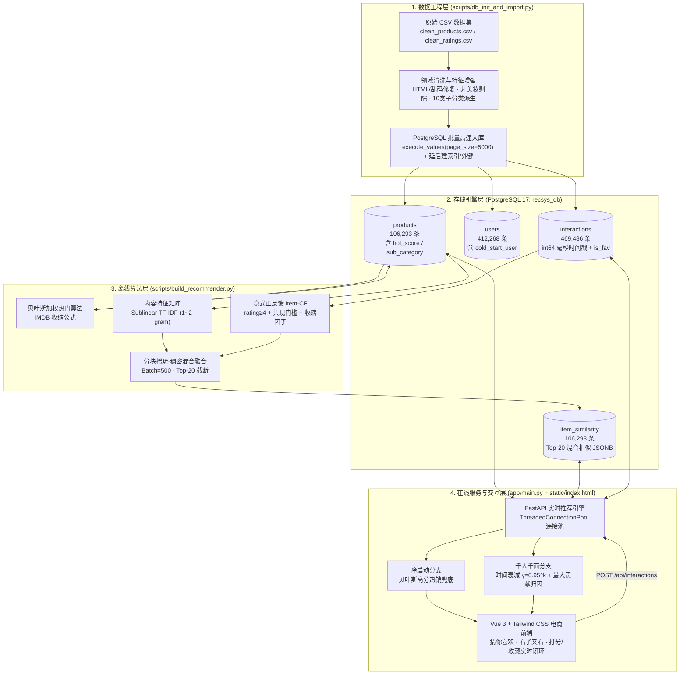
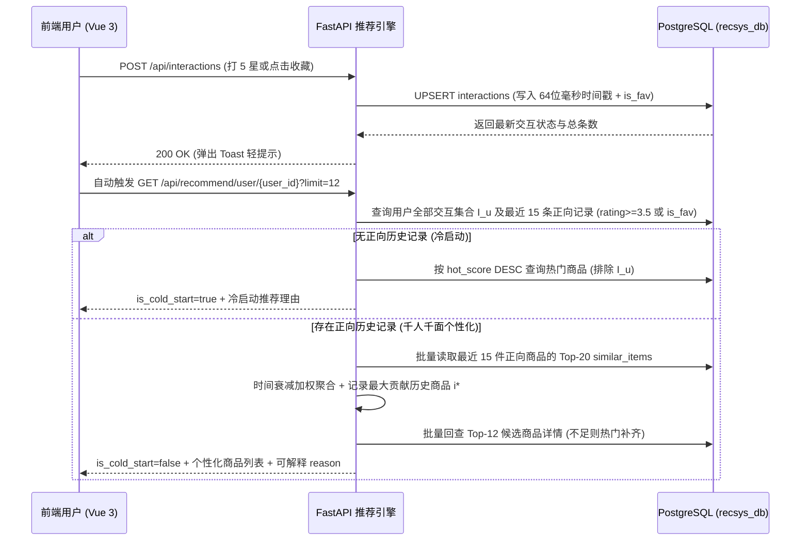

# 智选电商 · 个性化推荐系统项目实践报告

> **项目定位**：面向十万级商品与近五十万级交互规模的美妆垂直电商场景，基于 **PostgreSQL + SciPy/Scikit-Learn + FastAPI + Vue 3** 构建端到端（数据清洗 $\rightarrow$ 高速入库 $\rightarrow$ 离线混合模型预计算 $\rightarrow$ 在线实时重排与可解释推荐 $\rightarrow$ 交互反馈闭环）的个性化推荐系统。

---

## 目录

1. [项目背景与总体架构](#一项目背景与总体架构)
2. [技术栈选型与工程分工](#二技术栈选型与工程分工)
3. [数据工程：领域深度清洗与 PostgreSQL 高速导入](#三数据工程领域深度清洗与-postgresql-高速导入)
4. [核心推荐算法设计与数学原理](#四核心推荐算法设计与数学原理)
   - [4.1 算法一：贝叶斯加权热门得分（IMDB Weighted Rating）](#41-算法一贝叶斯加权热门得分imdb-weighted-rating)
   - [4.2 算法二：基于亚线性 N-gram TF-IDF 的内容相似度](#42-算法二基于亚线性-n-gram-tf-idf-的内容相似度)
   - [4.3 算法三：隐式正反馈 Item-CF 与共现收缩机制](#43-算法三隐式正反馈-item-cf-与共现收缩机制)
   - [4.4 算法四：内存安全的分块动态混合融合（Hybrid Recommender）](#44-算法四内存安全的分块动态混合融合hybrid-recommender)
   - [4.5 算法五：在线时间衰减个性化召回与可解释性归因](#45-算法五在线时间衰减个性化召回与可解释性归因)
   - [4.6 冷启动与多级降级兜底策略](#46-冷启动与多级降级兜底策略)
5. [前后端交互闭环与系统实现细节](#五前后端交互闭环与系统实现细节)
6. [实践过程中的关键问题排查与工程优化](#六实践过程中的关键问题排查与工程优化)
7. [项目实验与验证指标](#七项目实验与验证指标)
8. [项目使用指南与注意事项](#八项目使用指南与注意事项)

---

## 一、项目背景与总体架构

在真实电商推荐场景中，系统通常面临三大核心挑战：
1. **高稀疏性与长尾效应**：本数据集包含十万余件商品与四十余万名用户，人均历史评分仅 **1.14 条**，超过 90% 的用户仅有 1 条行为记录，纯协同过滤极易失效或受偶然共现噪声干扰。
2. **新用户与新商品冷启动**：新注册用户无任何历史偏好，长尾新上架商品缺乏用户评分交互。
3. **离线算力受限与在线低延迟要求**：在单机内存（16 GB）约束下无法直接构建 $10^5 \times 10^5$ 全量稠密相似度矩阵（需约 90 GB 内存），同时线上用户产生打分或收藏后，页面需在毫秒级内实时反馈最新的「猜你喜欢」推荐结果。

为此，本项目采用工业界经典的 **「离线预计算（Offline Precomputation）+ 在线实时聚合（Online Real-Time Scoring）」双层架构**：



---

## 二、技术栈选型与工程分工

| 层级 | 技术/组件 | 版本/规格 | 在项目中的核心作用 |
|---|---|---|---|
| **数据库层** | PostgreSQL | 17.x | 关系型主存储 + `JSONB` 半结构化存储 Top-20 相似商品列表 + 复合 B-Tree 索引加速排序与检索 |
| **数据库驱动** | `psycopg2-binary` | 2.9+ | 提供 `execute_values` 批量高速写入与 `ThreadedConnectionPool` 多线程连接池 |
| **数据处理层** | `pandas` / `numpy` | 2.2 / 1.26 | 向量化文本清洗、正则过滤、64 位时间戳处理、分位数计算与 `argpartition` 快速 Top-K 选择 |
| **科学计算与算法层** | `scipy.sparse` / `scikit-learn` | 1.13 / 1.5 | 构建 `csr_matrix` 稀疏矩阵、亚线性 N-gram `TfidfVectorizer` 特征提取、L2 归一化与稀疏矩阵乘法 |
| **后端服务层** | `FastAPI` + `Uvicorn` + `Pydantic` | 0.109+ / 0.27+ | 高性能 RESTful API、请求参数校验、静态资源挂载、实时个性化得分聚合与可解释理由生成 |
| **前端视图层** | HTML5 + Vue 3 + Tailwind CSS | Vue 3 (CDN) | 响应式单文件电商交互界面、体验账号一键切换、星级评价/一键收藏实时闭环、防竞态异步加载 |
| **工程化运维** | Python / Batch 脚本 | Python 3.12 | `推荐系统演示.bat` / `推荐系统演示.py` 自动目录切换、端口冲突检测与进程清理、服务健康自检与自动唤起浏览器 |

### 项目工程目录结构

```text
rcs_group3/
├── app/                            # 在线推荐后端服务 (FastAPI)
│   ├── __init__.py
│   └── main.py                     # 连接池管理、全套 REST API 与实时推荐引擎
├── config/                         # 统一配置中心（支持环境变量覆盖）
│   ├── __init__.py
│   ├── config.example.py           # 配置模板（纳入版本控制）
│   └── config.py                   # 本地真实数据库配置（由 .gitignore 忽略）
├── data/                           # 清洗后的美妆电商数据集（由 .gitignore 忽略）
│   ├── clean_products.csv          # 商品主数据（106,293 条）
│   └── clean_ratings.csv           # 用户交互数据（469,486 条）
├── docs/                           # 项目文档
│   └── 项目实践报告.md             # 本实践报告文档
├── scripts/                        # 离线数据工程与算法预计算脚本
│   ├── __init__.py
│   ├── db_init_and_import.py       # 阶段一：自动建库建表、深度清洗、派生子分类与高速入库
│   └── build_recommender.py        # 阶段二：贝叶斯热门得分与混合商品相似度预计算
├── static/                         # 前端静态资源
│   └── index.html                  # 阶段四：Vue 3 + Tailwind CSS 电商前端页面
├── tests/                          # 自动化验证与端到端测试
│   ├── __init__.py
│   ├── verify_results.py           # 数据库规模、热门榜单与相似推荐合理性验证
│   └── test_api.py                 # 全接口状态码与冷启动 -> 个性化实时切换闭环测试
├── 推荐系统演示.bat                # Windows 双击一键启动脚本
├── 推荐系统演示.py                 # Python 跨终端一键启动脚本
├── requirements.txt                # Python 依赖清单
└── README.md                       # 项目快速上手说明
```

---

## 三、数据工程：领域深度清洗与 PostgreSQL 高速导入

### 3.1 源数据探查与质量痛点

原始数据来自 Amazon Beauty 评价数据集，初始探查发现以下四类典型工程问题：
1. **跨品类脏数据污染严重**：尽管原始 `category` 字段标为 `All Beauty`，但卖家误标导致混入大量办公贴纸/信封、微波炉滤网、汽车配件、止吠器/宠物洗护、双碟电影 DVD 等非美妆商品，甚至占据了原始热门榜第 1、第 2 名。
2. **字符编码损坏与无效占位标题**：部分商品存在 HTML 实体未转义（如 `&`）及 UTF-8 二次编码乱码（如 `’`、`–`、`®`）；另有部分商品标题仅为 `'&&&&...'`、`'.'`、纯数字条形码或 `'Old Discontinued Listing Deleted'`。
3. **原始类目粒度过粗**：全库仅 `All Beauty`（99.6%）与 `Premium Beauty`（0.4%）两个原始类目，无法支撑前端分类筛选与同类目降级推荐。
4. **字段高缺失率**：`price` 缺失率约 **84.3%**，`description` 缺失率约 **78.8%**。

### 3.2 三层领域清洗与细分子分类派生

在 `scripts/db_init_and_import.py` 中设计了兼顾**召回率与精确率**的三层过滤流水线：

1. **字符修复与无效标题剔除（剔除 66 条）**：
   - 使用 `html.unescape` 与乱码映射表修复标题和描述；
   - 剔除长度 `< 4`、不含连续英文字母词根、或单一长串 SKU 乱码的记录。
2. **强非美妆黑名单 `HARD_NON_BEAUTY_RE`（剔除 2,025 条）**：
   - 针对成卷圆点标签贴纸、感谢贺卡信封、家电滤网（微波炉/冰箱/吸尘器）、宠物用品、DVD/ISBN 图书、迪士尼派对头箍、厨具与口服膳食补充剂等强特征词直接拦截（即使标题顺带提及 `"Essential Oil Bottle Labels"` 或电影 `"Hairspray"` 也精准剔除）。
3. **泛非美妆过滤 `SOFT_NON_BEAUTY_RE` + 核心美妆保护词 `BEAUTY_GUARD_RE`（剔除 4,194 条）**：
   - 当商品命中服饰、数码、五金、家纺、玩具等泛非美妆词，且**不含**任何美妆个护核心词时予以剔除；同时有效保护了「美甲贴纸（Nail Stickers）」「双眼皮贴（Eyelid Tape）」「真丝护发枕套（Satin Pillowcase for Hair）」等跨界美妆工具。
4. **级联交互清洗与 10 大美妆子分类派生**：
   - 按 `(user_id, item_id)` 去重（保留最新 `timestamp`），并级联剔除指向非美妆商品的 **30,514** 条无效评分，最终保留 **106,293 件纯净美妆商品**、**412,267 名真实用户**（外加 1 名冷启动测试账号）及 **469,486 条交互**。
   - 基于标题关键词优先级规则自动派生 `sub_category` 字段（假发发饰、彩妆、美容工具及其他、美发护发、护肤、美甲、身体沐浴、香水香氛、剃须脱毛、口腔护理共 10 类），使分类检索与同类兜底真正可用。

### 3.3 PostgreSQL 高速入库策略

针对近百万行总记录（商品 10.6 万 + 用户 41.2 万 + 交互 46.9 万）的入库性能要求，采取了三项关键优化：
- **批量值列表写入**：严禁逐行 `INSERT`，统一使用 `psycopg2.extras.execute_values(page_size=5000)`，将数千行拼装为单条多值 `INSERT INTO ... VALUES (...), (...)` 语句，大幅减少网络往返与 SQL 解析开销，每 `50,000` 行分批提交事务控制 WAL 膨胀。
- **先导数据、后建约束与索引（Post-Load Indexing）**：建表阶段仅保留主键与唯一约束，待三张表全量灌入完成后，再集中执行 `ALTER TABLE ... ADD CONSTRAINT` 建立外键以及 `CREATE INDEX` 构建二级索引（耗时仅 6.3 秒），避免插入过程中反复维护 B-Tree 与逐行检查外键。
- **统计信息即时刷新**：导入与预计算结束后自动执行 `ANALYZE`，确保 PostgreSQL 查询优化器生成最优执行计划。全流程阶段一总耗时仅 **41.7 秒**。

---

## 四、核心推荐算法设计与数学原理

### 4.1 算法一：贝叶斯加权热门得分（IMDB Weighted Rating）

#### 1. 问题背景
在构建「全站热销榜」与「新用户冷启动推荐」时，若直接按平均分 `avg_rating` 排序，仅有 1~2 人评价且拿了 `5.0` 满分的冷门商品会霸榜（**小样本方差偏差**）；若直接按评价人数 `rating_num` 排序，则早期上架但口碑平庸的商品会长期占据前列。

#### 2. 数学公式与贝叶斯收缩原理
采用经典的 **IMDB 贝叶斯加权评分公式（Empirical Bayes Shrinkage）**：

$$W = \frac{v}{v + m} \cdot R + \frac{m}{v + m} \cdot C$$

其中各参数物理意义及本库实测取值如下：
- $R$：当前商品的平均评分（`avg_rating`）；
- $v$：当前商品的评价总人数（`rating_num`）；
- $C$：全站所有商品 `avg_rating` 的先验均值，本数据集中 $C = 3.8781$；
- $m$：进入可信榜单所需的最小先验样本量阈值，取全站商品 `rating_num` 的 **80% 分位数**，本数据集中 $m = 37.0$（若极端情况下分位数为 0 则兜底取 5.0）。

**原理解析**：
该公式等价于假设每件商品在获得真实用户评分前，默认预先拥有 $m$ 个打分为全站均分 $C$ 的“虚拟先验评分”：
- 当 $v \ll m$（冷门商品）时，$\frac{v}{v+m} \to 0$，$\frac{m}{v+m} \to 1$，得分 $W$ 被强力拉向全站先验均分 $C$，有效抑制刷分或偶然满分；
- 当 $v \gg m$（热销爆款）时，$\frac{v}{v+m} \to 1$，得分 $W$ 渐近收敛于商品自身的真实口碑 $R$。

例如，某 `5.0` 分但仅 10 人评价的商品得分为 $\frac{10}{47}\times 5.0 + \frac{37}{47}\times 3.8781 \approx 4.1168$，而 `4.9` 分且有 1,027 人评价的护手乳液得分为 **4.8645**，排序合理性显著提升。

---

### 4.2 算法二：基于亚线性 N-gram TF-IDF 的内容相似度

#### 1. 特征构建与算法设计
针对约 78.8% 商品缺失详细描述及稀疏交互的长尾问题，将每件商品的 `title + " " + category + " " + description` 拼接并转为小写文本，通过 `TfidfVectorizer` 构建语义特征空间：

- **停用词过滤**：`stop_words='english'` 剔除无区分度的英文虚词；
- **二元词组捕获（`ngram_range=(1, 2)`）**：不仅保留单词（Unigram），还提取相邻双词组合（Bigram），从而精准区分 `"eye cream"`（眼霜）与 `"ice cream"`、`"hair oil"`（护发精油）与 `"oil free"`（无油配方）；
- **亚线性词频缩放（`sublinear_tf=True`）**：电商商品标题常堆砌重复营销词，采用对数词频替代原始线性词频：
  $$\text{tf}_{\text{sub}}(t, d) = \begin{cases} 1 + \ln f_{t,d}, & f_{t,d} > 0 \\ 0, & f_{t,d} = 0 \end{cases}$$
- **逆文档频率与 L2 归一化**：限制最高维数 `max_features=5000`（`float32` 存储），对每个商品特征向量 $\mathbf{x}_i \in \mathbb{R}^{5000}$ 做 L2 归一化（$\|\mathbf{x}_i\|_2 = 1$）。此时任意两件商品的内容余弦相似度可直接简化为向量内积：
  $$S_{\text{content}}(i, j) = \frac{\mathbf{x}_i \cdot \mathbf{x}_j^\top}{\|\mathbf{x}_i\|_2 \|\mathbf{x}_j\|_2} = \mathbf{x}_i \cdot \mathbf{x}_j^\top$$

最终得到的稀疏矩阵维度为 $106,293 \times 5,000$，非零元素 `nnz = 2,214,445`，密度仅 **0.42%**，内存占用不足 20 MB。

---

### 4.3 算法三：隐式正反馈 Item-CF 与共现收缩机制

在极度稀疏（人均 1.14 条评分）的数据集上，直接套用教科书式的原始评分余弦相似度会产生严重的“劣质推荐”与“偶然共现噪声”。本项目对 Item-CF 做了三项针对性算法改进：

#### 1. 改进一：隐式正反馈二值化（过滤差评信号）
原始交互中包含数万条 `1.0` 星与 `2.0` 星差评。若直接将原始分值代入余弦公式 $\frac{\sum_u r_{ui} r_{uj}}{\sqrt{\sum r_{ui}^2}\sqrt{\sum r_{uj}^2}}$，由于评分恒为正数，同一用户给 A、B 两件劣质商品都打了 `1.0` 星差评时，反而会贡献正向内积，导致系统“因为你讨厌 A，所以推荐另一个被讨厌的 B”。

因此，算法仅保留 $\text{rating} \ge 4.0$ 的交互记录（共 `334,789` 条，覆盖 `74,403` 件商品）作为**隐式正向偏好反馈**，构建二值交互指示量 $b_{ui} \in \{0, 1\}$。

#### 2. 改进二：单交互用户列剪枝与精确范数保持
仅有 1 条正向记录的用户在矩阵乘法 $B B^\top$ 中只对对角线（商品自身 $i = j$）有贡献，对任何不同商品对 $(i \ne j)$ 的共现贡献恒为 0。
- **矩阵剪枝**：剔除正向交互数 $< 2$ 的用户列，仅保留 $\ge 2$ 条正反馈的活跃用户（`24,389` 人，`nnz = 60,548`），使稀疏矩阵乘法提速一个数量级；
- **精确全局范数**：每个商品 $i$ 的 L2 归一化分母仍按**全量正反馈用户数** $d_i = \sum_{u \in \mathcal{U}_{\text{all}}} b_{ui}$ 计算（即乘以 $d_i^{-1/2}$），严格保证余弦相似度数值在数学上与未剪枝矩阵完全等价：
  $$\cos_{\text{cf}}(i, j) = \frac{n_{\text{co}}(i, j)}{\sqrt{d_i \cdot d_j}}, \quad n_{\text{co}}(i, j) = \sum_{u} b_{ui} b_{uj}$$

#### 3. 改进三：最小共现门槛 + BellKor 显著性收缩因子（Significance Shrinkage）
在稀疏场景下，若冷门商品 A（$d_A = 1$）与冷门商品 B（$d_B = 1$）恰好被同一个用户买过（$n_{\text{co}} = 1$），原始余弦相似度将高达 $\cos(A, B) = 1.0$！一旦乘上 0.6 的协同权重，这种纯属巧合的噪声就会压倒真正同品类的内容相似商品。

为此，引入双重去噪约束：
1. **最小共同用户数门槛**：要求共同正向评价用户数 $n_{\text{co}}(i, j) \ge 2$（`MIN_CO_USERS = 2`），单用户偶然共现一律置零；
2. **收缩惩罚因子（Shrinkage）**：借鉴 Netflix Prize 经典的 BellKor 协同过滤收缩公式，按共现样本量做置信度加权：
   $$\tilde{S}_{\text{cf}}(i, j) = \begin{cases} \cos_{\text{cf}}(i, j) \cdot \dfrac{n_{\text{co}}(i, j)}{n_{\text{co}}(i, j) + \lambda}, & n_{\text{co}}(i, j) \ge 2 \text{ 且 } i \ne j \\ 0, & \text{其他} \end{cases}$$
   其中收缩超参数 $\lambda = 3.0$（`SHRINK_LAMBDA`）。当 $n_{\text{co}} = 2$ 时，收缩系数为 $\frac{2}{5} = 0.4$；当 $n_{\text{co}} = 12$ 时，收缩系数上升至 $\frac{12}{15} = 0.8$，共同用户越多，协同信号越可信。

> **代数加速技巧**：由于二值矩阵下 $n_{\text{co}}(i, j) = \cos_{\text{cf}}(i, j) \cdot \sqrt{d_i d_j}$，代码直接从已算出的非零余弦结果反推共现人数 `co_vals = np.rint(cf.data / (inv_norm[row] * inv_norm[col]))`，省去了第二次稀疏矩阵乘法与慢速随机索引开销。

---

### 4.4 算法四：内存安全的分块动态混合融合（Hybrid Recommender）

#### 1. 内存复杂度分析与分块策略
若直接计算全量商品相似度稠密矩阵 $S \in \mathbb{R}^{106293 \times 106293}$：
- `float64` 需占用 $106293^2 \times 8 \approx 90.4\text{ GB}$ 内存；
- `float32` 亦需约 $45.2\text{ GB}$ 内存，必然引发单机 OOM 崩溃。

本项目采用**全量稀疏存储 + 滑动分块稠密融合 + 即时 Top-K 截断释放**策略：
- 以 `BATCH_SIZE = 500` 为单位，共分 $213$ 个批次遍历全部 `106,293` 件商品；
- 每个批次仅生成当前 500 件商品对全库商品的 `float32` 局部相似度矩阵 $S_{\text{batch}} \in \mathbb{R}^{500 \times 106293}$，单批峰值内存仅：
  $$500 \times 106,293 \times 4\text{ Bytes} \approx 202.7\text{ MB}$$
- 注意对角线排除自身时，按全局列偏移精准置零：`S[np.arange(bsz), np.arange(start, end)] = 0.0`。

#### 2. 动态自适应加权融合公式
对于当前批次中的每个商品 $i$：
$$S_{\text{hybrid}}(i, j) = \begin{cases} 0.6 \cdot \tilde{S}_{\text{cf}}(i, j) + 0.4 \cdot S_{\text{content}}(i, j), & \text{若 } \exists\, k \text{ 使 } \tilde{S}_{\text{cf}}(i, k) > 0 \\ S_{\text{content}}(i, j), & \text{若 } \forall\, k,\; \tilde{S}_{\text{cf}}(i, k) = 0 \end{cases}$$

**设计考量**：
- 对具备有效协同过滤信号的热门/活跃商品（占全库 1.7%，共 1,807 件高交互核心商品），赋予协同过滤更高权重（`0.6`），挖掘跨文本表述的真实共购/共评关联（例如买眼线笔的用户同时喜欢同品牌口红），同时保留 `0.4` 内容权重锚定品类相关性；
- 对无协同共现信号的长尾商品，自动无缝退化为 `1.0 * S_content`，既保证 **100% 的全库商品相似度覆盖率**，又避免因乘以 `0.4` 导致前端展示的匹配度百分比被人为腰斩。

#### 3. 线性时间 Top-20 提取
对每批矩阵使用基于快速选择（Quickselect）的 `np.argpartition(-S, 19, axis=1)[:, :20]`，将单行选出前 $K=20$ 大的时间复杂度从全排序的 $O(N \log N)$ 降至 **$O(N + K \log K)$**，序列化为 `[{"item_id": "...", "score": 0.6955}, ...]` 后通过 `execute_values` 批量写入 `item_similarity` 表，全程耗时约 **4 分钟**。

---

### 4.5 算法五：在线时间衰减个性化召回与可解释性归因

当已登录或切换的体验账号访问首页（`GET /api/recommend/user/{user_id}`）时，后端基于离线 `item_similarity` 表执行毫秒级在线个性化打分：



#### 1. 时间衰减个性化打分公式
设用户 $u$ 的全部已交互商品集合为 $\mathcal{I}_u$（用于去重，不再推荐用户已评过分或已收藏的商品），将其正向历史记录（满足 $\text{rating} \ge 3.5$ 或 $\text{is\_fav} = \text{True}$）按时间戳从新到旧排序，截取最近 $M \le 15$ 条记为序列 $(i_0, i_1, \dots, i_{M-1})$。

对于任意未交互候选商品 $j \notin \mathcal{I}_u$，其在线综合推荐得分为：

$$\text{RecScore}(u, j) = \sum_{k=0}^{M-1} \underbrace{w(u, i_k)}_{\text{用户偏好强度}} \cdot \underbrace{S_{\text{hybrid}}(i_k, j)}_{\text{混合商品相似度}} \cdot \underbrace{\gamma^k}_{\text{指数时间衰减}}$$

其中：
- **偏好强度权重 $w(u, i_k)$**：若用户收藏了商品 $i_k$（`is_fav = True`），视为最高偏好 $w(u, i_k) = 5.0$；否则取用户的实际打分 `rating`（$3.5 \sim 5.0$）；
- **时间衰减因子 $\gamma^k$**：取 $\gamma = 0.95$（`TIME_DECAY`）。用户刚刚点击打分或收藏的商品位于 $k = 0$，权重为 $0.95^0 = 1.00$；第 10 条历史行为权重衰减为 $0.95^9 \approx 0.63$；第 15 条衰减为 $0.95^{14} \approx 0.49$。这保证了**用户的即时意图能够第一时间体现在首页推荐结果的前排**，同时兼顾长期兴趣的多样性。

#### 2. 最大贡献归因（可解释性推荐理由生成）
可解释性（Explainability）是提升电商用户信任度与点击率的关键。在累加候选商品 $j$ 得分的同时，算法实时追踪对商品 $j$ 单笔贡献值最大的历史种子商品 $i_{k^*}$：

$$k^*(u, j) = \arg\max_{0 \le k < M} \Big[ w(u, i_k) \cdot S_{\text{hybrid}}(i_k, j) \cdot \gamma^k \Big]$$

根据用户对 $i_{k^*}$ 的行为类型动态生成自然语言解释标签：
- 若 `is_fav == True`：`💡 因为您收藏了「{title[:22]}...」`
- 若为星级评分：`💡 因为您给「{title[:22]}...」打了 {rating} 星`

---

### 4.6 冷启动与多级降级兜底策略

为保证线上任何极端场景下推荐栏位永远不出现空白（Zero-Empty Guarantee），系统构建了完整的三级兜底链路：
1. **用户冷启动兜底**：当 `positives` 为空（如新注册账号 `cold_start_user`，或某用户历史仅打过 1~2 星差评），自动启用贝叶斯 `hot_score` 榜单（并过滤掉其打过差评的商品），前端同步展示琥珀色【新用户冷启动模式】提示横幅。
2. **个性化召回数量补齐**：若某用户仅交互过 1 件极冷门商品且相似候选不足 `limit=12` 件，差额部分自动从全站高 `hot_score` 商品中去重补齐，并标注理由 `🔥 全站高分热销精选（为您补充）`。
3. **「看了又看」多级兜底**：在详情页相似商品接口 `/api/recommend/similar/{item_id}` 中，若目标商品相似列表因商品下架过滤后不足 6 件，依次按 **「同 `sub_category` 美妆子分类高热度商品 $\rightarrow$ 全站高热度商品」** 补齐，角标自动由 `匹配度 XX.X%` 切换为 `同类热门`。

---

## 五、前后端交互闭环与系统实现细节

1. **评分与收藏状态解耦（`is_fav` 独立字段）**
   - `interactions` 表以 `(user_id, item_id)` 为唯一约束。通过额外引入 `is_fav BOOLEAN` 字段，实现了**打分与收藏互不覆盖**：用户先打 4 星再点击收藏，原 4 星评分依然保留；取消收藏（`action_type='unfav'`）也仅将 `is_fav` 置为 `FALSE`，不会误删用户的历史评分。
2. **前端防竞态异步控制（Request Token）**
   - 在 `static/index.html` 中，针对用户快速连续切换体验账号或连续点击弹窗内「看了又看」商品的场景，设计了递增令牌（`recToken` / `detailToken`），自动丢弃慢速返回的过期响应，彻底杜绝界面数据闪烁与错位。
3. **体验账号一键复位机制**
   - 提供受保护接口 `DELETE /api/users/{user_id}/interactions`（后端校验 `RESETTABLE_USERS` 白名单，仅允许重置 `cold_start_user`，严禁删除真实用户历史数据）。当测试人员给冷启动账号打分体验完实时个性化跳变后，点击导航栏的 **「↺ 重置为新用户」** 即可一键恢复冷启动初始状态，方便反复演示。
4. **缺失价格真实透明展示**
   - 针对源数据约 84.3% 缺失 `price` 的客观情况，前端不伪造虚假价格，统一优雅展示为 `暂无报价`，避免误导用户。

---

## 六、实践过程中的关键问题排查与工程优化

在项目开发与自测迭代过程中，识别并解决了以下具有代表性的工程问题：

| 序号 | 发现的问题 | 根因分析 | 解决方案与工程收益 |
|---:|---|---|---|
| **1** | **Windows 下毫秒时间戳变成负数（数据损坏）** | CSV 中原始时间戳为 13 位毫秒值（约 $1.69 \times 10^{12}$），而在 Windows 64 位平台上 NumPy 的 `.astype(int)` 默认映射为 C `long`（即 **32 位有符号整数 `int32`**，上限 $2.14 \times 10^9$），导致入库前发生静默溢出截断。 | 将所有时间戳转换显式指定为 `np.int64`，同时后端新写入交互统一使用毫秒级 `int(time.time() * 1000)`，彻底对齐历史与实时时间轴。 |
| **2** | **热门榜前两名出现贺卡信封与微波炉滤网** | Amazon 原始数据集中部分第三方卖家将日用百货错误归入 `All Beauty` 类目，且评价数极高。 | 设计「强非美妆黑名单 + 泛非美妆过滤 + 核心美妆词保护」三层正则清洗器，精准剔除 6,285 条跨界脏商品与 30,514 条关联交互。 |
| **3** | **FastAPI 路由被动态参数提前吞噬** | 若 `/api/products/{item_id}` 注册在前，访问 `/api/products/hot` 会把 `"hot"` 当作 `item_id` 查询并返回 `404`。 | 严格控制路由注册顺序，将 `/api/products/hot` 与 `/api/products/search` 固定路径置于 `/api/products/{item_id}` 之前；静态目录 `/static` 置于文件末尾挂载。 |
| **4** | **`Decimal` 类型导致 JSON 序列化报错** | PostgreSQL 的 `NUMERIC` 字段经 `psycopg2` 读取后为 Python `Decimal` 对象，标准 JSON 序列化器不支持。 | 双保险处理：SQL 查询层显式转为 `::float8`，Python 响应层封装递归转换函数 `to_native()` 兜底转换。 |
| **5** | **Windows `.bat` 中文脚本乱码与行偏移报错** | `cmd.exe` 在批处理文件内部中途执行 `chcp 65001` 且文件为 `LF` 换行符时，按字节偏移重定位会切入 UTF-8 多字节汉字中间导致命令解析报错。 | 统一将 `推荐系统演示.bat` 转换为标准 `CRLF` 换行符，并将 `chcp 65001 >nul` 置于跳转目录后、启动 Python 前执行。 |

---

## 七、项目实验与验证指标

运行 `tests/verify_results.py` 与 `tests/test_api.py` 得到的实测指标如下：

- **数据规模与覆盖率**：
  - `products`：**106,293** 条（100% 有效美妆个护商品，覆盖 10 个派生子分类）
  - `users`：**412,268** 条（含 1 个冷启动测试账号）
  - `interactions`：**469,486** 条
  - `item_similarity`：**106,293** 条（覆盖率 **100.00%**，平均每件商品精准保留 **20.00** 个相似商品）
- **端到端耗时表现（单机 16 GB 内存，PostgreSQL 17）**：
  - 阶段一（清洗 + 约 98.8 万总记录导入 + 建外键/索引 + `ANALYZE`）：**41.7 秒**
  - 阶段二（贝叶斯 `hot_score` 回写 + 10.6 万商品 TF-IDF 特征提取 + Item-CF 矩阵构建 + 213 批混合相似度计算与入库）：**244.5 秒**
  - 阶段三在线接口响应：热门榜单、关键词 `ILIKE` 搜索、实时个性化推荐均在 **5 ~ 25 ms** 内返回。

---

## 八、项目使用指南与注意事项

### 8.1 一键启动与日常使用
- **最简启动方式**：直接双击项目根目录下的 `推荐系统演示.bat`（或在终端/PyCharm 中运行 `python 推荐系统演示.py`）。脚本会自动完成切换工作目录、检查 5432 数据库状态、清理 8000 端口旧进程、启动前后端服务并自动打开浏览器访问 `http://127.0.0.1:8000/`。

### 8.2 使用注意事项（必读）

1. **PostgreSQL 服务需保持运行**：
   - 启动演示前请确保本地 Windows 服务 `postgresql-x64-17`（端口 `5432`）处于 `Running` 状态。
   - 若在 **pgAdmin 4** 中查看外部脚本新建的 `recsys_db`，需右键左侧 `Databases` 节点点击 **`Refresh...`** 刷新目录树。
2. **本地配置文件安全与环境变量**：
   - 数据库密码保存在 `config/config.py` 中，该文件与 `data/*.csv` 均已被 `.gitignore` 忽略，**切勿强行提交至公开代码仓库**。团队协作时请复制 `config/config.example.py` 为 `config/config.py`，或通过环境变量 `DB_HOST` / `DB_PORT` / `DB_USER` / `DB_PASSWORD` / `DB_NAME` 注入。
3. **前端外部网络依赖（CDN）**：
   - 前端页面 `static/index.html` 通过 CDN 加载 **Tailwind CSS**（`cdn.tailwindcss.com`）与 **Vue 3**（`unpkg.com`），部分亚马逊商品图片加载自 `m.media-amazon.com`。演示机器需保持互联网连接（若图片因网络不可达加载失败，页面会自动降级显示内置 SVG 占位图，不影响功能演示）。
4. **离线层与在线层的职责边界**：
   - 用户在页面上的**打分与收藏会立即生效于「猜你喜欢」个性化推荐与「我的足迹」**（毫秒级实时闭环）。
   - 全站商品的 `avg_rating`、`rating_num`、`hot_score` 以及 `item_similarity` 属于离线批量计算产物，不会随单次点击实时重算全表；当线上累积了大量新增用户交互后，可定时（如每日凌晨）重新运行 `python scripts/build_recommender.py` 增量刷新离线相似度矩阵（无需重跑 `db_init_and_import.py`，以免清空线上新增交互！）。
5. **切勿在生产状态误跑初始化导入脚本**：
   - `scripts/db_init_and_import.py` 设计为幂等初始化脚本，内部包含 `DROP TABLE IF EXISTS ... CASCADE`，重新执行会将 4 张表重置回 CSV 初始状态并清空 `item_similarity`（若重新执行了阶段一，必须紧接着再运行一次 `python scripts/build_recommender.py`）。
